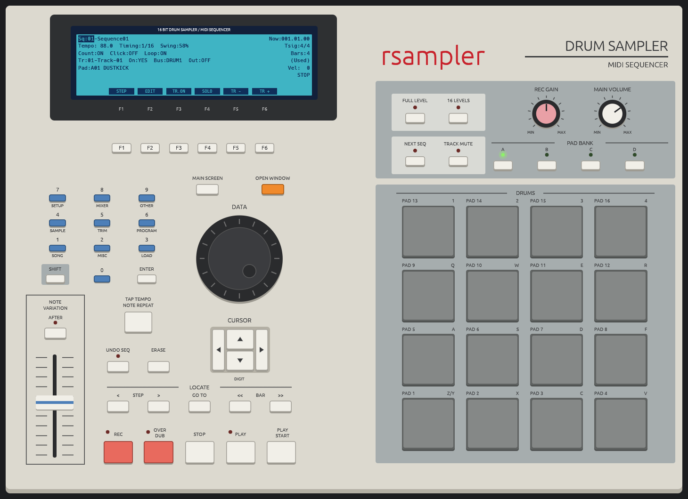

<p align="center">
  
</p>

<h1 align="center">rsampler</h1>

<p align="center">
  <a href="https://github.com/aronkv/rsampler/releases/latest"></a>
  <a href="https://www.rust-lang.org"></a>
  <a href="LICENSE"></a>
  
  <a href="https://github.com/aronkv/rsampler/actions/workflows/release.yml"></a>
</p>

<p align="center">A desktop sampler inspired by the Akai MPC2000XL, written in pure Rust.</p>

> **Status:** usable and close to the MPC2000XL: 24 programs on four DRUM buses, chopping,
> sound editing, effects, a 99-sequence, 64-track sequencer with MIDI tracks, song mode, step and
> bar editing, sampling from the input, MIDI in, out and clock, the MPC's own files, WAV export and
> project saving all work.

## Goals

- MPC2000XL-style screens in a native, lightweight GUI
- 16 velocity pads, four banks (A–D)
- Programs: sample assignment per pad, tuning, envelopes, mixer
- Sequencer: tracks, tempo, quantize, loop, step editing
- Sampling, song mode, MIDI in and out
- Loading and saving the original file formats (`.SND`, `.PGM`, `.APS`, `.SEQ`/`.MID`, `.ALL`)

## Platforms

Linux and Windows, from the same code. It is developed on Linux; the Windows build was tested on
Windows 11 (sound, keyboard pads on a Hungarian layout, recording, files, WAV and MIDI export, MIDI
out to the built-in GS Wavetable Synth). On Windows there is no own `rsampler` MIDI port, since
Windows has no virtual MIDI ports; choose an output in SETUP instead.

## Install

```sh
curl -fsSL https://raw.githubusercontent.com/aronkv/rsampler/main/install.sh | sh
```

On Linux x86_64 this downloads the latest prebuilt release (checksum-verified) into `~/.local/bin`;
set `RSAMPLER_INSTALL_DIR` to put it elsewhere. On Linux it also adds rsampler with its icon to the
app launcher (`~/.local/share/applications/rsampler.desktop`). On other systems it builds from source, which needs the
[Rust toolchain](https://rustup.rs) and, on Linux, the ALSA development files (the script tells you
the package name if they are missing). Then start it with `rsampler`.

On Windows, download `rsampler-x86_64-pc-windows-msvc.zip` from the
[releases page](https://github.com/aronkv/rsampler/releases), unzip it and run `rsampler.exe`.

From a local checkout, `cargo install --path .` does the same, and `cargo run` runs it without
installing.

## Usage

The full guide is at **[aronkv.github.io/rsampler](https://aronkv.github.io/rsampler/)**: getting
started, pads, the sequencer, programs and the mixer, editing sounds, files, MIDI and the keyboard
shortcuts.

In short: rsampler works like the MPC2000XL. The LCD shows one screen at a time, the **CURSOR**
keys (arrow keys) move between its fields, and the **DATA** wheel (scroll, or `+` / `-`) changes
the highlighted field. Pads 1–16 are on `Z X C V`, `A S D F`, `Q W E R` and `1 2 3 4`; `Space`
plays and stops, `Ctrl+R` records.

## Reference

[izzyreal/mpc](https://github.com/izzyreal/mpc) (the engine behind VMPC2000XL) is used as a behavioural and
file-format reference only. rsampler contains no code from it.

## Disclaimer

MPC® and Akai Professional® are registered trademarks of inMusic Brands, Inc. This project is not affiliated with,
endorsed by or sponsored by inMusic.

## License

Apache License 2.0, see [LICENSE](LICENSE).
