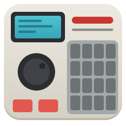

<p align="center">
  
</p>

<h1 align="center">rsampler</h1>

<p align="center">
  <a href="https://github.com/aronkv/rsampler/releases/latest"></a>
  <a href="https://www.rust-lang.org"></a>
  <a href="LICENSE"></a>
  
  <a href="https://github.com/aronkv/rsampler/actions/workflows/release.yml"></a>
</p>

<p align="center">A desktop sampler inspired by the Akai MPC2000XL, written in pure Rust.</p>

> **Status:** early development, but usable: pads, programs, mixer, trimming, a 99-sequence,
> 64-track sequencer, song mode, step editing, sampling from the input, MIDI in, out and clock,
> and project saving all work. See [Not there yet](#not-there-yet) for what is missing.

## Goals

- MPC2000XL-style screens in a native, lightweight GUI
- 16 velocity pads, four banks (A–D)
- Programs: sample assignment per pad, tuning, envelopes, mixer
- Sequencer: tracks, tempo, quantize, loop, step editing
- Sampling, song mode, MIDI in and out
- Loading and saving the original file formats (`.SND`, `.PGM`, `.APS`, `.SEQ`/`.MID`, `.ALL`)

## Platforms

Linux first. Windows builds are published too but get less testing; MIDI output is Linux-only
for now.

## Install

```sh
curl -fsSL https://raw.githubusercontent.com/aronkv/rsampler/main/install.sh | sh
```

On Linux x86_64 this downloads the latest prebuilt release (checksum-verified) into `~/.local/bin`;
set `RSAMPLER_INSTALL_DIR` to put it elsewhere. On Linux it also adds rsampler with its icon to the
app launcher (`~/.local/share/applications/rsampler.desktop`). On other systems it builds from source, which needs the
[Rust toolchain](https://rustup.rs) and, on Linux, the ALSA development files (the script tells you
the package name if they are missing). Then start it with `rsampler`.

On Windows, download `rsampler-x86_64-pc-windows-msvc.zip` from the
[releases page](https://github.com/aronkv/rsampler/releases), unzip it and run `rsampler.exe`.

From a local checkout, `cargo install --path .` does the same, and `cargo run` runs it without
installing.

## Usage

[Pads](#pads) · [NOTE VARIATION](#note-variation) · [Recording](#recording-a-sequence) ·
[EDIT](#edit-copying-bars-and-notes) · [SONG](#song) · [STEP EDIT](#step-edit) · [PROGRAM](#program-how-each-pad-plays) · [MIXER](#mixer) ·
[TRIM](#trim-loop-and-zone-editing-a-sound) · [Loading samples](#loading-samples) · [SAMPLE](#sample-recording-from-the-input) ·
[Projects](#saving-and-loading-projects) · [MIDI](#midi) · [Shortcuts](#keyboard-shortcuts)

rsampler works like the MPC2000XL: the LCD shows one screen at a time, the **CURSOR** keys move
between its fields, and the **DATA** wheel changes the highlighted field. The six keys under the LCD
(**F1–F6**) do what the labels above them say.

- **Cursor**: arrow keys or the **CURSOR** buttons. You can also click a field on the LCD.
- **DATA wheel**: drag or scroll over the wheel, scroll over the LCD, or press `+` / `-`. Hold
  **Shift** for fine steps (0.1 BPM tempo, 0.1 semitone tuning, single frames in a sound).

### Pads

Click a pad or hit its key. On the mouse, hitting higher on a pad plays louder; keys always play at
velocity 101 (changeable in SETUP), and **FULL LEVEL** (`F7`) makes everything 127.

The keys follow their physical position, so the layout works the same on QWERTY, QWERTZ (Hungarian,
German) and AZERTY keyboards:

| Row    | Pads  | QWERTY        | Hungarian QWERTZ |
| ------ | ----- | ------------- | ---------------- |
| top    | 13–16 | `1` `2` `3` `4` | `1` `2` `3` `4`    |
|        | 9–12  | `Q` `W` `E` `R` | `Q` `W` `E` `R`    |
|        | 5–8   | `A` `S` `D` `F` | `A` `S` `D` `F`    |
| bottom | 1–4   | `Z` `X` `C` `V` | `Y` `X` `C` `V`    |

Keys pressed together with Shift, Ctrl or Alt never play pads, so shortcuts and symbols such as
`+` (Shift+3 on a Hungarian keyboard) work.

**PAD BANK A–D** (`Tab` / `Shift+Tab`) switches between four banks of 16 pads (A01–D16). Bank A starts with a built-in
kick, snare, hi-hat and clap on pads 1–4. The last pad you hit is the selected pad that the
PROGRAM, MIXER, TRIM and LOAD screens work on.

**16 LEVELS** (`F8`) spreads one sound over all 16 pads and opens its ASSIGN screen: `Note` is the
pad whose sound is spread (the selected one to begin with), and `Param` what changes from pad to
pad:

- VELOCITY: velocity 7 on pad 1 up to 127 on pad 16.
- NOTE VAR: the `Type` TUNE, DECAY, ATTACK or FILTER changes across the pads. TUNE plays the
  sound at its own pitch on the `Original key pad` (4 by default) and a semitone higher on each
  pad after it, so a sound can be played like a keyboard; the others run from 6 on pad 1 to 96 on
  pad 16.

Notes recorded this way keep their variation. Press 16 LEVELS again to go back.

### NOTE VARIATION

The slider changes one pad's sound each time it is hit: drag it, scroll over it, or double-click
to centre it. **AFTER** opens its ASSIGN screen, where `Pad` chooses the pad and `Param` what the
slider changes:

| Param  | Slider bottom … top                                  |
| ------ | ---------------------------------------------------- |
| TUNE   | one octave down … one octave up (centre = no change) |
| DECAY  | 0 … 100                                              |
| ATTACK | 0 … 100                                              |
| FILTER | closed … open                                        |

The value is recorded with each note and played back with it. On the MPC, AFTER makes pad
pressure drive the variation; keyboards and mice have no pressure, so here it only opens ASSIGN.

### Recording a sequence

The MAIN screen (**MAIN SCREEN** or **Esc**) shows the sequencer:

| Field         | What it does                                                         |
| ------------- | -------------------------------------------------------------------- |
| `Sq`          | Sequence 1–99. Chosen while playing, it starts when the current one ends |
| `Now`         | Position as bar.beat.tick (96 ticks per quarter note)                |
| `Tempo`       | 30–300 BPM. **TAP TEMPO** (or `T`) sets it from your taps            |
| `Timing`      | Quantize grid for recording: OFF, 1/8, 1/16, 1/32 and their triplets |
| `Swing`       | 50–75 %, for 1/8 and 1/16                                            |
| `Tsig`        | Time signature                                                       |
| `Count`       | One bar of count-in before recording                                 |
| `Click`       | Metronome while playing and recording                                |
| `Loop`        | Loop the sequence                                                    |
| `Bars`        | Sequence length                                                      |
| `Tr`, `On`    | Track 1–64 and whether it plays                                      |
| `Out`         | MIDI channel the track's notes are sent on (see [MIDI](#midi)), OFF by default |

To record:

1. Press **REC** (replace) or **OVERDUB** (add). Its light shows it is armed.
2. Press **PLAY** or **PLAY START**. After the count-in, play the pads.
3. Press **STOP**.

**REC** erases what is on the track as the playhead passes, and turns into **OVERDUB** after the
first loop so the new take is kept. Pressing **REC** or **OVERDUB** while playing punches in or out.
Notes are quantized to `Timing` as they are recorded; **OPEN WINDOW** on the `Timing` field (timing
correct) quantizes a whole track afterwards.

**UNDO SEQ** (`Ctrl+Z`) takes back the last recording or edit; its light shows that it can.
Hold **ERASE** (or `Delete`) while playing and hold pads to delete their notes as the playhead
passes. **TR.ON** (F3) mutes the track, **SOLO** (F4) plays only this track, and **TR -** / **TR +**
(F5/F6) change track.

**TRACK MUTE** (`F10`) turns the pads into track switches, for muting parts live: pad 1 mutes or
unmutes track 1, and so on, with PAD BANK B–D for tracks 17–64. The LCD shows the tracks laid out
like the pads, `*` marking those with notes. **SOLO** (F6) and then a pad plays only that track;
SOLO again brings all tracks back.

**NEXT SEQ** (`F9`) does the same for sequences: while playing, a pad queues its sequence (pad 1 =
sequence 1, bank B = 17–32, …) to start when the current one ends; while stopped it selects it.
Press either key again to go back to MAIN.

**NOTE REPEAT**: while playing, hold **TAP TEMPO / NOTE REPEAT** (or `T`) and hold pads; they play
again on every `Timing` grid line (1/16 when `Timing` is OFF) and are recorded when recording.
While stopped the same key taps the tempo.

**LOCATE**: **STEP <** / **>** move by the `Timing` grid, **BAR <<** / **>>** by a bar, and
**GO TO** returns to the start. **STOP** pressed while stopped also returns to the start.

### EDIT: copying bars and notes

**EDIT** (F2 on the MAIN screen) works on whole stretches of a sequence, like the MPC's EDIT mode.
It opens on the whole current sequence; **EVENTS** (F1) and **BARS** (F2) switch between its two
pages, and **DO IT** (F6) applies the edit and returns to MAIN. **UNDO SEQ** takes it back. Times
move by bars, or by beats with Shift.

**BARS** copies bars, the quickest way to turn a 2-bar loop into 8 bars: bars `First bar` to
`Last bar` of `From sq` are inserted `Copies` times into `To sq` after `After bar` (0 = before the
first bar), and the bars after them move back. Both sequences need the same time signature.

**EVENTS** works on the notes of the current track (`Sq`, `Tr`) within `Time`, of one pad or ALL
(`Notes`):

| Edit     | What it does                                                                 |
| -------- | ---------------------------------------------------------------------------- |
| COPY     | Copies the notes to `To sq` / `tr` from `Start`, `Copies` times one after another. REPLACE clears that stretch first, MERGE adds to it |
| DURATION | Changes their length: `Mode` ADD VALUE, SUB VALUE, MULTI VAL% or SET TO VAL, by `Value` ticks (or percent) |
| VELOCITY | Changes their velocity the same way, between 1 and 127                        |

### SONG

The blue **1 / SONG** key (`Ctrl+1`) chains sequences into a song. **INSERT** (F1) adds a step after
the selected one, playing the sequence chosen on the MAIN screen; **DELETE** (F2) removes it.
**↑** / **↓** choose a step, and its `Sq` and `Reps` (how many times it plays) are set with the
DATA wheel. `Loop` starts the song over at the end.

On this screen **PLAY START** plays the song from the first step and **PLAY** from the selected
one; `>` marks the step that is playing. Song mode does not record.

### STEP EDIT

**STEP** (F1 on the MAIN screen) lists the notes of the current track. **↑** / **↓** choose a note
and move `Now` to it; **←** / **→** move between its position, pad, velocity and duration, and the
DATA wheel changes them (position and duration move by the `Timing` grid, or by single ticks with
Shift). Hitting a pad while stopped adds a note at `Now`, so you can step-record with **STEP <** /
**>**. **DELETE** (F1) removes the selected note, **TR -** / **TR +** change track, and **UNDO SEQ**
takes back everything done since opening the screen.

### PROGRAM: how each pad plays

Open it with the blue **6 / PROGRAM** key. Hit a pad (or change `Pad`) to choose it.

| Field     | What it does                                                               |
| --------- | -------------------------------------------------------------------------- |
| `Tune`    | ±12 semitones, in 0.1 steps                                                 |
| `Attack`  | Fade-in time, 0 = instant                                                  |
| `Decay`   | Fade time, up to two seconds (default 5, a short fade)                     |
| `Dcy md`  | END fades out over the decay time before the sound ends; START dies away from the end of the attack, slower for larger values |
| `Filter`  | Low-pass cutoff, 100 = open                                                |
| `Reso`    | Filter resonance                                                           |
| `Overlap` | POLY layers repeated hits, MONO cuts the previous hit, NOTE OFF stops when the pad is released |
| `Mutes`   | Up to two pads this pad cuts off, e.g. a closed hi-hat stopping an open one |
| `Mode`    | NORMAL; SIMULT also plays the two `Also` pads, layered; VEL SW plays another pad when hit harder than its threshold (`Over 64:A02 100:A03`: above 64 plays A02, above 100 plays A03) |
| `Level`, `Pan` | Same as in the mixer                                                  |

**CLEAR** (F6) removes the pad's sound.

**VELO** (F4) opens the VELO/ENV window. Its first part is velocity modulation: how much the
strength of a hit shapes the sound, each 0–100, for expressive playing from MIDI pads:

| Field         | What it does                                                         |
| ------------- | -------------------------------------------------------------------- |
| `Velo>Level`  | Softer hits are quieter; 100 (the default) follows velocity fully, 0 plays every hit at full level |
| `Velo>Attack` | Softer hits fade in more slowly                                      |
| `Velo>Start`  | Softer hits start later into the sound, skipping the sharp beginning |
| `Velo>Filter` | Harder hits open the filter further (set `Filter` below 100 first)   |

Below it is the FILTER ENVELOPE: on each hit the filter opens by `Amount` over `Attack`, then
closes back to `Filter` over `Decay` (each 0–100, up to five seconds), the classic sweep of a
filtered bass or a "wah" on a drum. It needs `Filter` below 100. **PROGRAM** (F1) goes back.

### MIXER

The blue **8 / MIXER** key shows the 16 pads of the current bank as level faders with pan markers.
**←** / **→** choose the pad, **↑** selects `Level` and **↓** selects `Pan`, and the DATA wheel sets
the value. **RESET** (F6) returns the pad to full level, centre.

### TRIM, LOOP and ZONE: editing a sound

The blue **5 / TRIM** key (`Ctrl+5`) shows the selected pad's waveform. **TRIM** (F1), **LOOP** (F2)
and **ZONE** (F3) switch between the three views, as on the MPC. On all three, **PLAY X** (F6)
plays the highlighted part once, as it is, and **EDIT** (F5) opens the EDIT window on it.

**TRIM**: `St` and `End` set the part of the sound that plays. **RESET** (F4) restores the whole
sound.

**LOOP**: with `Loop` ON the sound jumps back from `End` to `To` for as long as the pad is held
(or, in a sequence, for the length of the note), then fades out over its decay. `Lngth` moves `To`
so the loop gets longer or shorter. A looping sound always plays as NOTE OFF, as on the MPC.
**RESET** (F4) turns the loop off.

**ZONE** chops the sound: `Zones` splits it into 1–16 equal zones, back to back. `Zone` picks one,
and its `St` and `End` move the boundaries it shares with its neighbours, so no part is lost or
played twice. **RESET** (F4) splits it evenly again.

Every point moves by 1/500 of the sound per DATA wheel step, or by single frames with Shift.

**EDIT** works on St–End from TRIM, on the loop from LOOP, and on the selected zone from ZONE:

| Edit                  | What it does                                                   |
| --------------------- | -------------------------------------------------------------- |
| DISCARD               | Keeps only the section and throws away the rest                |
| LOOP FROM ST TO END   | Sets `To` to `St` and turns `Loop` on                           |
| SECTION -> NEW SOUND  | Copies the section to `To pad`                                 |
| DELETE SECTION        | Cuts the section out                                           |
| SILENCE SECTION       | Makes the section silent                                       |
| REVERSE SECTION       | Plays the section backwards                                    |
| TIME STRETCH          | Puts the section on `To pad` made longer or shorter at the same pitch: `Ratio` is the new length, 50–200 % (1 % a step, 0.1 % with Shift) |
| NORMALIZE SECTION     | Raises the section until its loudest point is at full level    |
| SLICE SOUND (ZONE)    | Puts every zone on its own pad, from `To pad` on               |

**DO IT** (F5) applies it, **CANCEL** (F4) goes back. New sounds are named after the original
(`KICK-1`, `KICK-2`, …) and their pads start from the default settings. To chop a break onto 16
pads: load it on a pad, go to ZONE, set `Zones` to 16, fix the boundaries by ear with PLAY X, then
EDIT, SLICE SOUND, `To pad` B01, DO IT. Edits cannot be undone, as on the MPC.

To fit a loop to the sequence tempo, stretch it by the old tempo over the new: a 90 BPM break in a
95 BPM sequence needs 90 / 95 = 94.7 %.

### Loading samples

1. Hit the pad you want to load into.
2. Press **LOAD** (the blue `3` key). The browser opens in `~/Music`.
3. Move with the arrow keys or the **DATA** wheel.
4. **Enter**, **→**, **ENTER** or **F6** opens a folder, or loads the sound into the pad and plays it.
5. **Backspace**, **←** or **F1** goes up a folder.

**PLAY** (F5) listens to the selected WAV or `.SND` file without loading it; **STOP** or leaving
the screen stops it.

WAV files of any bit depth and sample rate work, mono or stereo. The MPC2000XL's own `.SND`
sounds load too, with their trim points, loop and tuning, so old MPC sound libraries can be used
directly.

An MPC2000XL program (`.PGM`) loads onto all 64 pads at once (press `Enter` twice): each pad gets
its sound from the `.SND` files next to the program, with the program's tuning, envelope, filter,
overlap, mute assign, SIMULT / VEL SW mode, velocity modulation, filter envelope, level and pan.
Sounds that are not there are listed on the LCD.

### SAMPLE: recording from the input

The blue **4 / SAMPLE** key (`Ctrl+4`) opens the default audio input; it is closed again when you
leave the screen. Hit the pad the new sound should go to, then:

| Field       | What it does                                                            |
| ----------- | ----------------------------------------------------------------------- |
| `Mode`      | STEREO, or MONO (both channels mixed)                                   |
| `Threshold` | The recording starts when the input gets this loud; OFF starts at once   |
| `Time`      | Longest take, 1–60 seconds                                              |

**REC GAIN** (drag or scroll) sets the input level from −12 to +12 dB; the meters show the input
from −60 to 0 dBFS with the threshold marked. **REC** (F6) waits for the threshold and records,
**STOP** ends the take early, then **KEEP** (F6) puts it on the pad as `SAMPLExx` and plays it, or
**RETRY** (F5) records again. Use TRIM afterwards to cut off silence.

### MIDI files

A MIDI file (`.mid`) chosen on the LOAD screen replaces the current sequence (press `Enter` twice;
**UNDO SEQ** brings the old one back), with its tempo, time signature and length, one track per
MIDI track. Notes 36–99 play pads A01–D16. Sequences saved by an MPC2000XL use its own drum note
numbers, so load the matching `.PGM` first: its pad assignments are then used for the notes.

**MIDI** (F4) on the SAVE screen writes the current sequence as `<name>.mid`, to open in a DAW.

### Saving and loading projects

A project is a folder holding `rsampler.json` (sequences, pad settings, mixer) and the pad sounds as
WAV files in `sounds/`, so the sounds can be used anywhere else too.

To save, press `Ctrl+S`, **SHIFT + ENTER** or **SAVE** (F2) on the LOAD screen:

1. Pick the folder to save in, like on the LOAD screen.
2. Press **NAME** (F5), type the name and press `Enter`. Choosing an existing project in the list
   takes its name.
3. Press **DO IT** (F6). Replacing an existing project asks for a second **DO IT**.

**Exporting audio:** on the same SAVE screen, **WAV** (F3) writes the current sequence, played
once from the start, as `<name>.wav`, and **SONG** (F2) the whole song as `<name>-song.wav`: 24-bit
stereo at the output sample rate, with muted tracks left out, SOLO respected, and the last sounds
left to ring out. It renders faster than real time, so nothing has to play.

Once a project has been saved or loaded, `Ctrl+S` saves over it straight away.

To load, choose the project (marked `PROJECT`) on the LOAD screen and press `Enter` twice; loading
replaces everything that is open.

Closing the window with unsaved changes shows a warning on the LCD instead; close it again to quit
without saving.

### MIDI

**In:** rsampler listens to every MIDI input it finds, including controllers plugged in while it
runs, and on Linux it also offers its own `rsampler` input port for other programs. Notes 36–99
(C1–D#6) play pads A01–D16 with their velocity, whatever bank is selected, and are recorded like
pad hits. Most 16-pad controllers send 36–51 by default, which lands on bank A.

**Out:** `MIDI out` in SETUP chooses where MIDI goes: on Linux by default rsampler's own
`rsampler` port, for a synth or DAW to connect to, or straight to any MIDI port the system has (a
USB interface, a synth, or on Windows the built-in Microsoft GS Wavetable Synth); OFF sends
nothing. The choice is saved with the project. A track whose `Out` field is set to a channel sends
its notes there as it plays (pad A01 = note 36 again), and pads you hit pass through on the
selected track's channel, so the pads can play an external synth.

**Clock out:** with `MIDI clock out` on in SETUP, rsampler sends MIDI clock while playing, and
start, stop, or song position and continue, so a DAW or drum machine can follow its tempo.

**Clock in:** with `Sync` set to MIDI CLOCK in SETUP, rsampler follows another device instead: it
starts, stops and locates when the master does, plays at the master's tempo (shown as `EXT` on the
MAIN screen and in SETUP) and stays locked to its clock pulses. PLAY on rsampler itself is disabled
while syncing; STOP still works.

### SETUP and OTHER

The blue **7 / SETUP** key (`Ctrl+7`) holds `MIDI clock out`, `Sync` (INTERNAL or MIDI CLOCK),
the velocity of pads hit from the computer keyboard (101 by default) and the `MIDI out` port; all
are saved with the project. **9 / OTHER** (`Ctrl+9`)
shows the version and the output sample rate.

### Keyboard shortcuts

| Key                         | Does                         |
| --------------------------- | ---------------------------- |
| `Space`                     | PLAY / STOP                  |
| `Shift+Space`               | PLAY START                   |
| `Ctrl+R` / `Ctrl+O`         | REC / OVERDUB                |
| `Ctrl+Z`                    | UNDO SEQ                     |
| `Ctrl+S`                    | Save                         |
| `+` / `-`                   | DATA wheel                   |
| `Delete` (hold)             | ERASE                        |
| `T`                         | TAP TEMPO (stopped), NOTE REPEAT (held while playing) |
| `,` / `.`                   | STEP < / >                   |
| `Page Up` / `Page Down`     | BAR << / >>                  |
| `Home`                      | GO TO start                  |
| `F1`–`F6`                   | Soft keys                    |
| `F7` / `F8`                 | FULL LEVEL / 16 LEVELS       |
| `Tab` / `Shift+Tab`         | Next / previous PAD BANK     |
| `F9` / `F10`                | NEXT SEQ / TRACK MUTE        |
| `Ctrl+1` / `3`–`9`          | SONG / LOAD, SAMPLE, TRIM, PROGRAM, SETUP, MIXER, OTHER |
| `Esc`                       | MAIN SCREEN                  |

### Not there yet

- Windows-specific testing
- The MISC mode
- INSERT SOUND in the EDIT window
- Loading the MPC's `.SEQ`, `.APS` and `.ALL` files; its `.SND` sounds, `.PGM` programs and
  `.MID` sequences already load

## Reference

[izzyreal/mpc](https://github.com/izzyreal/mpc) (the engine behind VMPC2000XL) is used as a behavioural and
file-format reference only. rsampler contains no code from it.

## Disclaimer

MPC® and Akai Professional® are registered trademarks of inMusic Brands, Inc. This project is not affiliated with,
endorsed by or sponsored by inMusic.

## License

Apache License 2.0, see [LICENSE](LICENSE).
